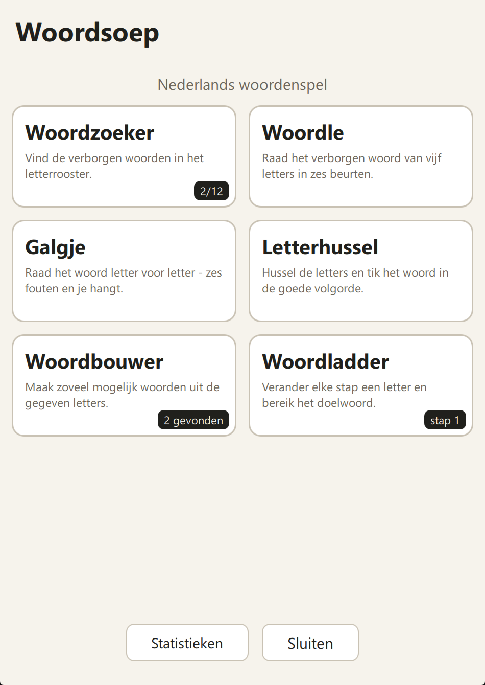
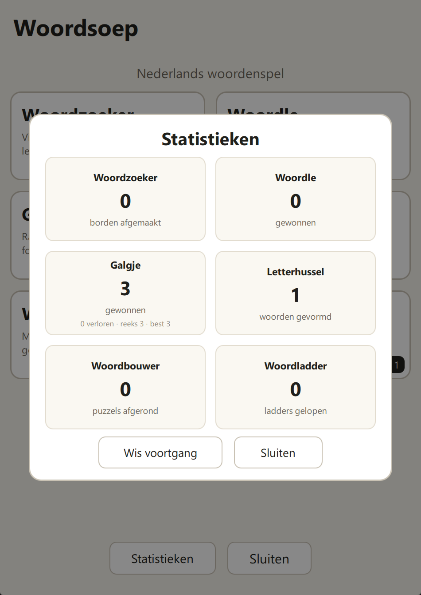

# Woordsoep — Nederlands woordenspel voor de reMarkable Paper Pro Move

Een klein, offline woordenspel voor je Paper Pro Move, te sideloaden met
**reManager**. Zes spellen in één app:

| Spel | Wat het is |
| --- | --- |
| **Woordzoeker** | Vind verborgen woorden in een letterrooster. Sleep met je vinger of pen over de letters, of tik op de eerste en laatste letter van een woord. |
| **Woordle** | Raad het verborgen woord van vijf letters in zes beurten, met het schermtoetsenbord. |
| **Galgje** | Raad het woord letter voor letter — zes fouten en het poppetje hangt. |
| **Letterhussel** | Tik de gehusselde letters in de goede volgorde. |
| **Woordbouwer** | Maak zoveel mogelijk woorden uit de gegeven letters. |
| **Woordladder** | Verander elke stap één letter en bereik het doelwoord. |

De woordvoorraad is lekker groot: **ruim 850 woorden** in **15 categorieën**
(voor Woordzoeker, Galgje, Letterhussel, Woordbouwer en Woordladder) plus
**490 vijfletterwoorden** voor Woordle. Elk spel kiest telkens opnieuw
woorden, dus je raakt nooit door de voorraad heen.

Alles is in het Nederlands en werkt volledig offline (de woordenlijsten zitten
in de app). De app is een **AppLoad-app** (frontend-only, in QML/JavaScript) —
hetzelfde formaat als de officiële AppLoad-voorbeelden.

<p align="center">
  
  
</p>

---

## 1. Voorbereiding (eenmalig)

1. **Developer mode** aanzetten op je Move (reMarkable-vereiste; dit wist je
   tablet, dus synchroniseer eerst je notities).
2. **reManager** installeren op je pc en verbinden met je Move
   (USB-verbinding: `10.11.99.1`). reManager zet Vellum automatisch voor je op.
3. In reManager, tab **Mods**:
   - zoek en installeer **AppLoad** (de afhankelijkheden, waaronder **xovi**,
     worden automatisch meegeinstalleerd);
   - aanbevolen: installeer ook **tripletap** — dan zet je de mods aan met
     drie keer kort op de powerknop, zonder computer.
4. Start de mods op je tablet: **drie keer op de powerknop** (met tripletap),
   of in reManager: **Maintenance → Start UI with Mods**.

> Tip: houd je reMarkable-OS redelijk actueel en zet automatische
> OS-updates uit via reManager (Maintenance), zodat je mods blijven werken.
> Na een OS-update: reManager → Maintenance → **Reenable**.

## 2. De app installeren via reManager

De app bestaat uit één mapje `woordspel` met drie bestanden. Er zijn twee
manieren; **manier A is voor de meeste mensen het makkelijkst**.

> De map op de tablet heet nog steeds `woordspel` (technische naam uit de
> begintijd van de app, toen hij nog *Woordspel* heette). Uploaden naar
> dezelfde map werkt dus gewoon als update van de oude versie.

### Manier A — map uploaden met de File Browser

1. Open in reManager: **Utilities → File Browser**.
2. Navigeer naar `/home/root/xovi/exthome/appload/`.
   (Bestaat de map `appload` nog niet? Dan is AppLoad nog niet gestart —
   herhaal stap 3–4 van de voorbereiding.)
3. Klik **Upload Folder** (of sleep de map) en kies de map
   **`dist/woordspel`** uit deze repository.
4. Klaar. Ga verder met stap 3 hieronder.

### Manier B — zip uploaden en uitpakken in de terminal

1. reManager → **Utilities → File Browser** → upload `dist/Woordsoep.zip`
   naar `/home/root/` (de map maakt hij zelf aan als je de zip in de
   File Browser sleept).
2. Open **Utilities → Terminal** en voer uit:

   ```sh
   mkdir -p /home/root/xovi/exthome/appload
   unzip -o /home/root/Woordsoep.zip -d /home/root/xovi/exthome/appload/
   rm /home/root/Woordsoep.zip
   ```

3. (Werkt `unzip` niet? Gebruik dan manier A.)

## 3. Starten

1. Zorg dat de mods draaien: **drie keer op de powerknop** (als je tripletap
   hebt geinstalleerd) of reManager → **Maintenance → Start UI with Mods**.
2. Open op de tablet de **AppLoad**-launcher (de knop in de navigator-zijbalk).
3. Tik zo nodig op **Reload** in AppLoad: de app **Woordsoep** verschijnt met
   zijn icoon.
4. Tik op het icoon en spelen maar!

## 4. Zo speel je

Elk spel heeft rechtsboven een **?**-knop die de spelregels uitlegt.

**Woordzoeker**
- Tik rechtsboven op de **categorie-knop** (bijv. *Categorie: Alles*) om te
  wisselen tussen de 15 categorieën: Dieren, Eten, Natuur, Huis, Sport,
  Beroepen, Lichaam, Kleding, Vervoer, School, Muziek, Kleuren, Stad,
  Werkwoorden en **Alles** (alles door elkaar). Tik naast het venstertje om
  het menu te sluiten.
- Elk rooster verstopt **12 woorden** van 4 tot 8 letters.
- Sleep met je vinger of pen van de eerste naar de laatste letter van een
  woord, of tik eerst op de eerste en dan op de laatste letter.
- Gevonden woorden kleuren in het rooster en krijgen een streep in de
  lijst eronder.
- Vastgelopen? Tik op **Tip**: één vakje van een nog niet gevonden woord
  licht kort goud op.
- Alle woorden gevonden? Gebruik **Nieuw** voor een nieuw rooster — de
  woorden en hun plek worden elke keer opnieuw gekozen.

**Woordle**
- Gebruik het toetsenbord onderaan. **WIS** = één letter wissen, **OK** = raden.
- Groen = goede letter op de goede plek, geel = letter zit in het woord,
  grijs = letter zit niet in het woord.
- Je hebt zes beurten. Daarna kun je met **Nieuw woord** verder.

**Galgje**
- Kies een categorie en raad letters via het toetsenbord. Goede letters komen
  in beeld en kleuren groen; foute letters kleuren grijs.
- Na zes fouten is het poppetje compleet en zie je het woord.
- Klaar? Druk op **OK** voor meteen een nieuw woord.

**Letterhussel**
- Tik de letters één voor één aan in de goede volgorde. Zodra het laatste
  vakje gevuld is, wordt het woord gecontroleerd.
- **Hussel** gooit de letters opnieuw door elkaar (handig als ze "moeilijk"
  in de weg liggen); **Hint** onthult een volgende letter; tik op een
  geplaatste letter om die terug te leggen.

**Woordbouwer**
- Typ met het toetsenbord woorden van minstens 4 letters met de gegeven
  letters. **OK** = nakijken, **WIS** = letter wissen.
- Gevonden woorden komen in de lijst te staan. Vind ze allemaal!

**Woordladder**
- Ga van het beginwoord naar het doelwoord; elke stap mag je precies één
  letter veranderen (HOND → HAND → LAND).
- **Hint** tipt een woord dat past, **Stap terug** haalt een stap weg.

**Terug / afsluiten**
- Pijltje linksboven = terug naar het menu. **Sluiten** in het menu sluit de
  app (of gebruik het AppLoad-closegebaar: vanaf de bovenrand naar beneden
  slepen).

**Voortgang bewaren**
- Maakt niet uit hoe je stopt: je voortgang wordt automatisch bewaard. Open
  je de app later weer, dan ga je verder waar je gebleven was — hetzelfde
  rooster of woord, dezelfde gevonden woorden en beurten.
- Op de menukaarten zie je een klein zwart labeltje als je ergens midden in
  een potje zit (bijv. *2/12* of *bezig*) — zo zie je in één oogopslag waar
  je nog mee bezig was.
- **Nieuw** (bij Woordzoeker) of **Nieuw woord** (bij Woordle) begint pas een
  écht nieuw spel.

**Statistieken**
- Onderaan het menu staat de knop **Statistieken**: elk spel heeft daar een
  eigen tegel met hoe vaak je hebt gewonnen, plus je reeksen (en de
  beurtenverdeling van Woordle).
- Wil je helemaal opnieuw beginnen? Tik twee keer op **Wis voortgang**
  (de eerste tik vraagt om bevestiging) — alle spelvoortgang én statistieken
  worden gewist.

## 5. Problemen oplossen

| Probleem | Oplossing |
| --- | --- |
| App niet zichtbaar in AppLoad | Tik op **Reload** in AppLoad; controleer of de map `/home/root/xovi/exthome/appload/woordspel/` de drie bestanden bevat. |
| AppLoad helemaal niet te zien | Mods niet gestart: drie keer op de powerknop of reManager → Maintenance → **Start UI with Mods**. |
| Zwart/wit i.p.v. kleuren | Bijna niet nodig: het scherm is een kleurenscherm (Gallery 3); kleuren komen vanzelf. |
| Na een OS-update werkt niets | reManager → Maintenance → **Reenable** en daarna opnieuw starten. |
| Verkeerde weergave/rotatie | Eventueel reManager-pakket **fix-appload-rotation** installeren. |
| SSL-/certificaatfouten bij het bouwen (aqt) | Dot-source eerst `. .\tools\fix_python_tls.ps1` en gebruik `py tools\run_aqt.py` i.p.v. `py -m aqt`. |
| `qml.exe` niet gevonden bij het testen op de pc | Installeer ook het `qtdeclarative`-pakket (zie sectie 6) en probeer opnieuw. |

## 6. Zelf aanpassen en opnieuw bouwen

- **Woorden**: `app/ui/WoordzoekerLogic.js` (15 categorieën, ruim 850 woorden
  van 4–8 letters) en `app/ui/WoordleLogic.js` (490 woorden van 5 letters).
  De hulpscripts controleren de lijsten automatisch: alleen letters A–Z, geen
  dubbele woorden en per categorie minimaal 30 woorden.
- **Puzzeldata**: `app/ui/WoordbouwerPuzzles.js` en
  `app/ui/WoordladderPuzzles.js` zijn automatisch gegenereerd uit de
  woordenlijsten, met `node tools/make_bouwer_puzzles.js` en
  `node tools/make_ladder_puzzles.js` (opnieuw draaien geeft een nieuwe
  selectie puzzels).
- **Uiterlijk/teksten**: `app/ui/Main.qml` (menu, hulp, statistieken) plus één
  bestand per spel: `Woordzoeker.qml`, `Woordle.qml`, `Galgje.qml`,
  `Letterhussel.qml`, `Woordbouwer.qml`, `Woordladder.qml`. Het toetsenbord
  zit in `Kb.qml` + `KeyCap.qml` en het bewaren van voortgang in `Store.js`.
- **App-naam en icoon**: `app/manifest.json` (het veld `name`) en
  `app/icon.png` (opnieuw te maken met `tools/make_icon.py`).

Opnieuw bouwen (Windows):

```powershell
# eenmalig: hulpmiddelen + Qt (qtbase = rcc; qtdeclarative = qmllint + pc-testomgeving)
py -m pip install --user aqtinstall truststore
. .\tools\fix_python_tls.ps1    # alleen nodig op machines met TLS-inspectie/SSL-klachten
py tools\run_aqt.py install-qt windows desktop 6.6.3 win64_msvc2019_64 --archives qtbase qtdeclarative --outputdir .qt

# bouwen -> dist\woordspel + dist\Woordsoep.zip
powershell -ExecutionPolicy Bypass -File tools/build.ps1
```

> In deze workspace staat Qt al klaar in `.qt\`; opnieuw bouwen is dan gewoon
> het `build.ps1`-commando, en testen op de pc kan met `run_testbed.ps1`.

Controleren:

```powershell
py tools/validate_words.py     # woordenlijsten nakijken (lengtes, dubbele woorden, per-categorie-aantallen)
node tools/test_logic.js       # spellogica testen: 15 categorieën × 40 puzzels (Node.js nodig)
```

De QML-bestanden worden via `application.qrc` in `resources.rcc` gebundeld met
Qt's `rcc --binary`; dat is precies wat AppLoad verwacht.

### Testen op de pc (zonder tablet)

De app kan ook in een gewoon venster op de pc draaien — handig om snel layout
en spelgedrag te checken. Met de muis kun je slepen en klikken alsof het je
vinger op de tablet is:

```powershell
powershell -ExecutionPolicy Bypass -File tools\run_testbed.ps1
```

Er opent een venster van 950×1570 (het schermformaat van de Move; op kleinere
schermen wordt het venster automatisch iets kleiner) met de app erin. De
tablet-module `net.asivery.ApploadUtils` (die AppLoad normaal levert) is voor
de testomgeving gemockt in `tools/testbed/imports`. Sluiten kan met de
**Sluiten**-knop in de app, met Escape of met het kruisje van het venster.

Wil je het testen automatiseren? Met `tools\testbed\_probe.ps1` maak je vanaf
de opdrachtregel screenshots en stuur je kliks of toetsaanslagen naar het
venster — bijvoorbeeld:

```powershell
powershell -ExecutionPolicy Bypass -File tools\testbed\_probe.ps1 -Action shot -Out shot.png
powershell -ExecutionPolicy Bypass -File tools\testbed\_probe.ps1 -Action click -X 200 -Y 300
```

(Screenshots belanden als `_*.png` in `tools\testbed\` en worden door git
genegeerd.)

> Dit is alleen om te testen; het echte pakket in `dist\` verandert hier niets
> van.

## 7. Verwijderen

- File Browser → `.../appload/woordspel` verwijderen, of in de Terminal:

  ```sh
  rm -rf /home/root/xovi/exthome/appload/woordspel
  ```

- Daarna **Reload** in AppLoad.

## 8. Optioneel: in de Vellum-winkel publiceren

Wil je de app via de gewone reManager-pakkettenlijst installeerbaar maken,
dan kan dat met een Vellum-pakket (PR naar `vellum-dev/vellum`, zie hun
README). Voorbeeld `packages/woordspel/VELBUILD`:

```sh
maintainer="Jouw Naam <jij@example.com>"
pkgname=woordspel
pkgver=1.0.0
pkgrel=0Zes Nederlandse woordspellen (Woordzoeker, Woordle, Galgje, Letterhussel, Woordbouwer, Woordladder
upstream_author="jouw-github-naam"
category="apps"
pkgdesc="Nederlands woordenspel (Woordzoeker + Woordle) voor AppLoad"
url="https://github.com/jouw-github-naam/woordspel"
arch="noarch"
license="MIT"
depends="appload"

_commit="<git-commit-sha-van-jouw-repo>"
source="https://raw.githubusercontent.com/$upstream_author/woordspel/$_commit/dist/woordspel/manifest.json
https://raw.githubusercontent.com/$upstream_author/woordspel/$_commit/dist/woordspel/icon.png
https://raw.githubusercontent.com/$upstream_author/woordspel/$_commit/dist/woordspel/resources.rcc"

package() {
	install -d "$pkgdir"/home/root/xovi/exthome/appload/woordspel
	install -Dm644 "$srcdir"/manifest.json "$pkgdir"/home/root/xovi/exthome/appload/woordspel/manifest.json
	install -Dm644 "$srcdir"/icon.png "$pkgdir"/home/root/xovi/exthome/appload/woordspel/icon.png
	install -Dm644 "$srcdir"/resources.rcc "$pkgdir"/home/root/xovi/exthome/appload/woordspel/resources.rcc
}
```

(Dat kan pas nadat je deze map naar GitHub hebt gepusht; de sha512-sommen vul
je aan met `./scripts/update-checksums.sh woordspel`.)

## 9. Bijdragen

Ideeën, verbeteringen en bugmeldingen zijn van harte welkom: open een issue
of stuur een pull request op GitHub.

## 10. Licentie

MIT — doe ermee wat je wilt. Zie [LICENSE](LICENSE).

## Technische details

- **App-formaat**: AppLoad frontend-only app — `manifest.json` +
  `resources.rcc` + `icon.png` in `/home/root/xovi/exthome/appload/<id>/`.
  Het manifest verwijst met `entry` naar `/ui/Main.qml` *binnen* de rcc.
- **QML**: gebruikt alleen `QtQuick` + `QtQuick.Layouts`-vrije, klassieke
  items (geen Controls), zodat de app op de OS-Qt-runtime blijft werken.
  `net.asivery.ApploadUtils` wordt geïmporteerd zoals in de officiële
  voorbeelden.
- **Doelapparaat**: reMarkable Paper Pro Move (954×1696, OS 3.2x).
  Op de Paper Pro / Paper Pure werkt dezelfde structuur vrijwel zeker.
- **Voortgang bewaren**: via Qt's `Settings`-mechanisme (JSON onder een
  eigen sleutel per spel: `zoeker`, `woordle`, `galgje`, `hussel`, `bouwer`,
  `ladder`, plus `stats` voor de statistieken). Op de tablet komt dat in
  `~/.config` terecht (bij root: `/home/root/.config`), op de pc in het
  register. Ontbreekt de Settings-module onverwacht, dan blijft de app
  gewoon werken — alleen zonder voortgang bewaren.
- **Licentie**: MIT (zie `LICENSE`).
